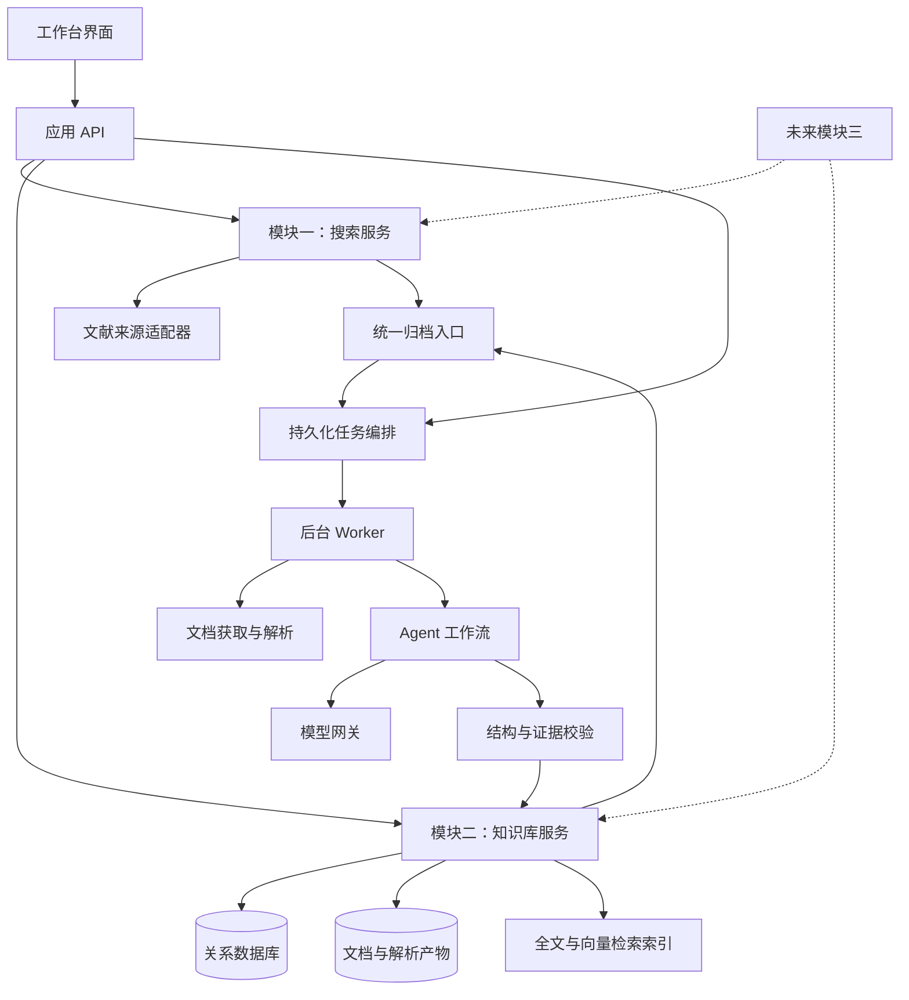

# AI Agent 论文工作台：系统架构设计

版本：v0.1  
日期：2026-10-24  
状态：初始需求与架构背景。系统架构以 [4+1 视图主文档](02-系统架构4+1视图.md) 为准。

## 1. 目标与已确认范围

构建面向技术研究的论文工作台，形成“用户发起检索 → 自动发现论文 → 自动阅读 → 提取技术方案 → 多维归档”的完整流程。

已确认的产品约束：

- 用户主动发起搜索；第一版不包含定时监控。
- Agent 自动完成检索、阅读、分类、技术总结和归档，不需要人工审核后入库。
- 技术树采用人工确定的初始骨架；Agent 可以建议新增节点，由用户确认后调整正式技术树。
- 后续扩展探索由用户选择目标：同类方法、前后续工作、不同技术路线、未解决问题。
- 第一版不实现技术迁移验证，只预留入口和接口边界。
- 实施顺序：系统架构 → 模块二详细设计 → 模块一详细设计 → 模块二开发 → 模块一开发 → 再考虑模块三。

本文明确架构职责、数据边界和端到端流程；具体字段、API 请求格式、提示词及页面交互在详细设计阶段确定。

## 2. 模块与第一版边界

| 模块 | 职责 | 第一版范围 |
| --- | --- | --- |
| 模块一：论文搜索 | 理解主题、生成查询、调用文献来源、合并去重、排序筛选 | 实现用户发起的搜索与自动归档衔接 |
| 模块二：技术知识库 | 文献接收、正文解析、技术提取、三维分类、索引与查询 | 优先实现，是系统核心 |
| 模块三：知识库应用 | 扩展探索、技术迁移验证 | 本阶段不开发，只保留可扩展接口 |

模块二必须能够通过上传 PDF、提交 DOI/论文链接或导入元数据独立工作，不依赖模块一已实现。链接或 DOI 无法获得全文时，保留元数据与可访问摘要，并标明阅读范围。

第一版默认按单用户工作台设计。多用户权限、团队协作和分布式部署不进入本阶段；数据模型保留知识库标识，避免所有数据绑定为一个不可拆分的全局库。

## 3. 总体架构

采用模块化单体后端与独立后台任务进程。模块共享数据库，通过明确的应用服务接口协作，暂不拆分微服务。



架构原则：

1. **工作流控制过程，Agent 承担判断。** 重试、预算、持久化和状态迁移由程序控制；查询生成、阅读提取和分类由模型完成。
2. **论文与技术方案分开建模。** 文献是证据载体，技术方案是后续对比与迁移的对象。
3. **自动归档允许信息不完整，但不能隐藏信息缺失。** 摘要阅读与全文阅读明确区分。
4. **事实与推断分开。** 论文报告的结论、Agent 的概括以及迁移推测不能混为一谈。
5. **外部能力均通过适配器接入。** 文献来源、模型服务、解析器可替换。

## 4. 模块二：技术知识库的核心模型

### 4.1 主要实体

| 实体 | 作用 | 关键关系 |
| --- | --- | --- |
| Paper（论文） | 规范化的文献身份、标题、作者、摘要、状态 | 对应多个版本、多个技术方案 |
| PaperVersion（论文版本） | 预印本、会议版、期刊扩展版等具体来源版本 | 对应文档、发表记录及提取结果 |
| Document（文档） | PDF、正文、解析结果和可访问性信息 | 属于一个论文版本 |
| Evidence（证据） | 原文片段、章节、页码或段落定位 | 支撑技术描述、分类和实验结论 |
| Technique（技术方案） | 原理、目标问题、关键机制、适用条件、局限 | 关联论文、技术域和问题域 |
| ExperimentFinding（实验发现） | 原文报告的实验环境、基线、指标、结果 | 关联技术方案与证据 |
| TaxonomyNode（分类节点） | 技术树、问题树中的稳定节点 | 有父节点、别名和版本信息 |
| Classification（分类关联） | 多对多归类、分类依据和置信度 | 关联论文或技术方案及节点 |
| Venue / Publication（发表来源） | 会议或期刊规范名、别名、年份等 | 关联论文版本 |
| TaxonomyProposal（分类扩展建议） | 建议新增、合并或调整节点及理由 | 确认后更新正式分类 |
| Job / StepRun（任务与步骤） | 输入、状态、重试、耗时和产物引用 | 串联搜索、解析、归档 |

一篇论文可包含多个技术方案；同一技术方案也可以由多篇论文共同讨论。但第一版不让模型仅凭名称相近就合并跨论文技术：先保留独立条目与“疑似同源/改进”关联，后续再完善技术实体归一。

### 4.2 三维归档

**技术域：技术作用于哪个系统层次、使用什么机制。**

初始骨架建议：

```text
技术域
├─ 体系结构
│  ├─ 核与微架构
│  ├─ Cache 系统
│  │  ├─ Cache 预取
│  │  ├─ Cache 替换
│  │  └─ Cache 压缩
│  └─ 内存
│     ├─ 内存介质
│     ├─ 访问效率优化
│     └─ 容量压缩
├─ 编译器
├─ 操作系统
└─ 软件与算法
```

**问题域：技术希望改善什么目标或瓶颈。**

```text
问题域
├─ 性能优化
│  ├─ 取指优化
│  ├─ 执行效率优化
│  └─ 访存系统优化
│     ├─ 访问延迟
│     ├─ 带宽利用
│     └─ 数据局部性
├─ 低功耗与节能
└─ 存储成本优化
   ├─ 容量需求降低
   └─ 存储介质成本降低
```

**来源域：论文在哪里发表。** 以规范化的会议、期刊、预印本平台与发表年份组织，不将出版社或平台等同于发表场所。未知来源明确记录为未知，不由模型猜测。

三个维度独立建模并联合筛选。例如：技术域为“Cache 压缩”、问题域为“访存系统优化”、来源为某会议且年份满足区间的论文及技术方案。

第一版分类树节点具有单一父节点；条目可以关联多个节点，实现跨域分类。技术树中的“访问效率优化”与问题树中的“访存系统优化”可以并存，但其含义分别是技术位置/方向与解决目标。

### 4.3 自动分类与技术树演进

1. 模型优先从正式技术树和问题树选择节点，并给出证据与置信度。
2. 没有合适叶节点时，归入最接近的正式上级节点，同时产生节点扩展建议。
3. 没有可信的上级分类时，记录“未分类”；任务仍可成功归档。
4. 用户批量处理技术树建议；不需要逐篇审核论文或技术总结。
5. 分类树变更记录版本；受影响条目可以在后台重新分类，保留历史记录。

低置信度只影响展示标识和检索权重，不引入人工审批门槛。自动校验失败则进行有限次修复；仍失败的步骤标记失败，不把无效结构写入正式技术数据。

## 5. 模块一：论文搜索

搜索请求包含主题、可选补充描述、时间范围、来源范围、结果数量上限和执行预算。第一版不承诺穷尽所有相关文献。

流程：

1. 将主题转换为技术术语、同义词、限定条件和若干查询式。
2. 通过来源适配器检索，保留原始查询和来源结果。
3. 规范化 DOI、来源 ID、标题和发表信息，合并明确重复的结果。
4. 根据主题相关性排序，说明入选理由；引用量或年份只是辅助因素。
5. 根据用户在发起任务时给定的数量与预算选择自动阅读、归档的集合。
6. 将候选文献提交模块二统一归档入口，展示检索与归档的分阶段进度。

文献来源候选包括学术元数据服务、预印本平台、出版方页面及用户给定链接。具体提供方、API 可用性、凭证、配额和全文获取方式在模块一详细设计时核验，不在架构阶段假定所有来源都可访问。

全文不可访问时不绕过访问限制；记录摘要级阅读、缺失原因与合法来源链接。用户以后补充全文，可继续丰富原条目而不重复创建论文。

## 6. Agent 运行机制

逻辑角色划分为查询规划、论文阅读、技术提取、分类、结构与证据检查。它们是可独立测试的工作流步骤，不要求分别部署为服务，也不默认采用自由讨论的多 Agent 系统。

每个模型步骤遵循：

- 输入是版本化模板、必要上下文、正式分类节点与明确的输出结构。
- 输出使用结构化数据，由程序校验必填字段、枚举、关联对象与证据引用。
- 论文中的指令性文字按研究材料处理，不能改变系统规则或触发任意工具执行。
- 阅读长文采用分章节提取后汇总，保留各结论的原文位置。
- 保存模型标识、模板版本、输入文档哈希和执行记录，支持定位错误与重新运行。
- 论文未提供的信息填写未知，不补造实验环境、指标、来源或技术结论。

涉及实验数值时，保留单位、基线、工作负载与原文报告范围，避免将特定实验结果概括为普遍收益。

## 7. 任务编排与一致性

搜索任务与归档任务分别持久化。搜索任务可以产生多个论文归档子任务，某篇失败不阻断其他论文。

任务状态至少包括：排队、执行中、部分完成、完成、失败、取消。步骤单独记录状态与失败原因；“摘要级完成”属于数据完整度，不等同于任务失败。

归档步骤：身份解析 → 元数据保存 → 文档获取 → 解析 → 内容提取 → 分类 → 校验 → 结构化保存 → 索引更新。

- 使用来源 ID、规范化 DOI、文档哈希等执行精确去重；标题相似仅产生候选重复，不自动误合并。
- 模型处理幂等键包含目标版本、文档哈希及处理模板版本。
- Worker 使用数据库任务领取与租约机制；进程崩溃后任务可恢复，过期租约允许重新领取。
- 外部限流或暂时错误采用有上限的退避重试；永久失败不无限重试。
- 数据库保存与待索引事件在同一事务提交；索引异步刷新且可重建，避免索引故障导致已归档数据丢失。
- 重跑产生新的处理记录，成功后替换当前有效结果；失败时不覆盖已有有效归档。
- 用户可取消任务；已保存结果保留，停止后续步骤。正在执行的外部调用可能无法立即中断。
- 为任务设论文数、模型调用量、Token、运行时间与并发上限，达到上限时保存已有结果并明确停止原因。

## 8. 存储与技术选型建议

以下为拟采用的实现基线，具体依赖版本在详细设计和开发前核验。

| 层次 | 建议 | 理由 |
| --- | --- | --- |
| 前端 | TypeScript + React | 支持树形浏览、筛选、任务进度和论文详情 |
| 后端 | Python + FastAPI | 便于组织文献处理和模型调用逻辑 |
| 主数据库 | PostgreSQL | 保存文献、分类、技术条目和任务状态 |
| 检索 | 关系筛选、文本检索与 pgvector 向量检索组合 | 同时支持精确筛选与语义查询；中文检索方案在详细设计验证 |
| 文档存储 | 本地文件存储，提供统一存储接口 | 第一版降低部署复杂度，之后可替换为对象存储 |
| 后台执行 | 独立 Python Worker + 数据库任务队列 | 第一版减少额外基础设施，保持任务可恢复 |
| 模型访问 | 统一模型网关 | 分离生成模型、嵌入模型及服务商配置 |

数据库是事实来源，向量索引是派生产物。嵌入模型变更时通过索引版本隔离并重建，不混用不同维度或语义空间的向量。

文档解析通过适配器提供原文块与定位；扫描 PDF 的 OCR 作为可选能力。解析质量不足时明确降级或标记失败，不能把空白正文当成已阅读全文。

部署上先支持本地工作台：浏览器访问前端，后端与 Worker 在本机运行，数据库独立运行。具体启动方式在详细设计时结合 Windows 环境确定。

## 9. 服务边界与页面组成

模块二对外提供：

- 提交归档：接收文件、文献标识、链接或标准化搜索候选。
- 查询任务：查看阶段、结果、错误、预算与取消状态。
- 查询知识库：三维筛选、关键词或语义查询。
- 查询详情：论文版本、技术方案、原文证据、实验发现与处理记录。
- 管理分类：查看树、确认扩展建议、触发重新分类。
- 丰富归档：补充全文、更新元数据、重新处理。

模块一调用模块二的归档服务，不直接操作模块二内部数据表。未来模块三通过稳定的知识查询、证据读取和搜索请求接口接入。

第一版页面：

1. 知识库首页：技术树、问题树、来源筛选与条目列表。
2. 论文详情：摘要、阅读范围、技术方案、分类、证据和原文链接。
3. 技术详情：原理、目标问题、适用条件、局限和论文报告的实验结果。
4. 导入与任务中心：手动导入、任务进度、失败重试与取消。
5. 分类管理：初始骨架、节点调整和 Agent 扩展建议。
6. 搜索页：主题与约束、实时结果、自动归档进展。

模块三仅在架构中预留服务边界；如展示入口，应明确标注尚未实现，不生成伪造验证结果。

## 10. 质量、安全与可观测性

- 每个重要技术结论提供可回溯的原文证据；仅有摘要的条目明确提示。
- 来源文献、网页及 PDF 均作为不可信输入；限制下载体积、超时和解析资源，URL 获取阻止访问本地或内网敏感地址。
- 模型只能使用该步骤允许的工具；文献内容不能授权执行代码或读取本机文件。
- 模型密钥保存在服务端配置中，不写入前端、论文条目或日志。
- 外部模型只接收完成步骤所需的文本；具体服务商与数据发送范围在配置中明确。
- 记录任务成功率、全文获取率、解析失败率、分类未覆盖率、模型用量、耗时与重试次数。
- 日志通过任务 ID 串联；备份同时覆盖数据库与原文文件，索引可由持久化数据重建。

## 11. 实施阶段与验收门槛

### 阶段 A：系统架构（本文）

明确模块边界、核心数据对象、自动化规则、任务机制和技术基线。

### 阶段 B：模块二详细设计

交付数据表与关系、字段结构、归档流程与状态机、API 契约、页面设计、分类策略、模型输入输出约束和验证方案。

优先定义可供模块一调用的标准化文献输入与归档任务契约。

### 阶段 C：模块一详细设计

核验并选择文献来源，定义查询规划、结果归一、去重、排序、预算、全文获取与自动归档衔接。对模块二契约的调整在开发前统一完成。

### 阶段 D：模块二开发

验收要求：

- 上传论文后，无需人工审核即可完成解析、技术提取、三维分类与查询。
- 一篇论文可以关联多个技术方案和多个分类节点。
- 关键结论能够定位到原文；未知信息不被填成事实。
- 摘要级与全文级处理明确区分，后补全文不会制造重复论文。
- 分类树缺少节点时可自动归档，并提出可处理的扩展建议。
- 重复提交、部分失败、进程中断和重试不导致重复条目或丢失已完成结果。

### 阶段 E：模块一开发

验收要求：

- 用户发起主题搜索后，系统在指定数量与预算内自动检索、筛选、阅读并归档。
- 每个候选保留来源与相关性说明，明确重复项不重复归档。
- 某来源失败或某论文不可访问时，任务保留其他有效结果并说明缺失原因。
- 用户可以看到从检索到归档的完整进度与最终完成范围。

### 阶段 F：模块三（后续立项）

再确定扩展探索的交互和执行策略；技术迁移验证需另行明确目标环境、实验工具、代码执行与评估标准。

## 12. 后续设计需落实的事项

这些事项不阻塞本架构，但必须在对应详细设计中明确：

- 初始技术树与问题树的最终骨架及节点定义。
- 首批文献来源及其访问条件、配额、凭证要求。
- 生成模型、嵌入模型、预算默认值及数据发送范围。
- 首版论文语言、PDF 类型覆盖范围及中文查询策略。
- Windows 本地启动方式、数据库安装与备份流程。
- 用于验收的少量代表性论文与预期技术条目，覆盖多技术、多分类、全文缺失和扫描文档等情况。

默认优先支持英文计算机领域论文，允许中文主题输入和中文技术总结；这是可调整的设计假设，不是用户已确认的限制。
