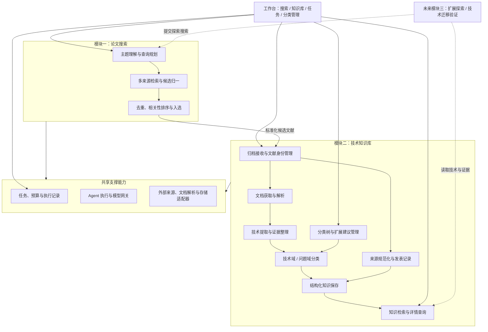
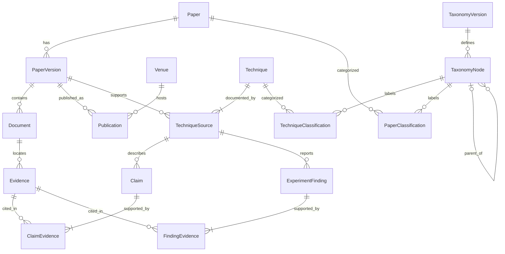
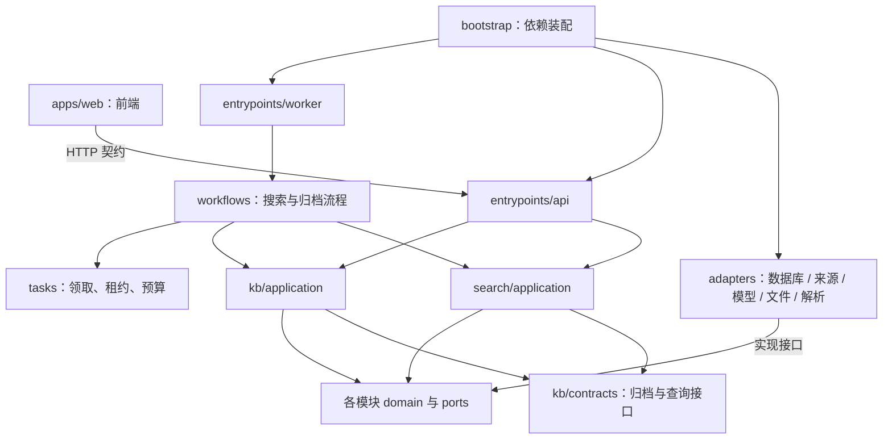
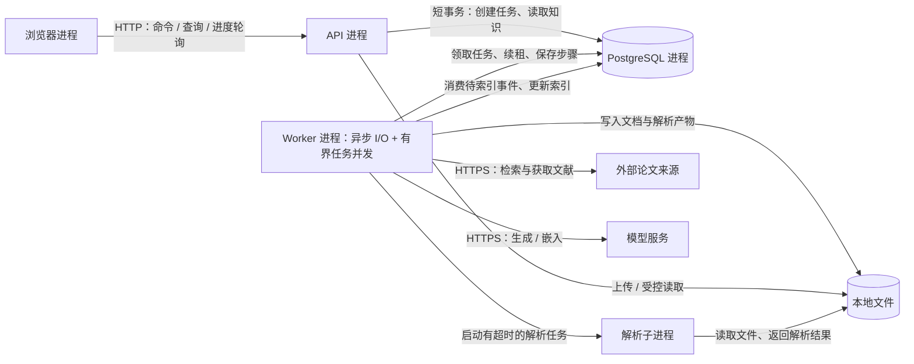
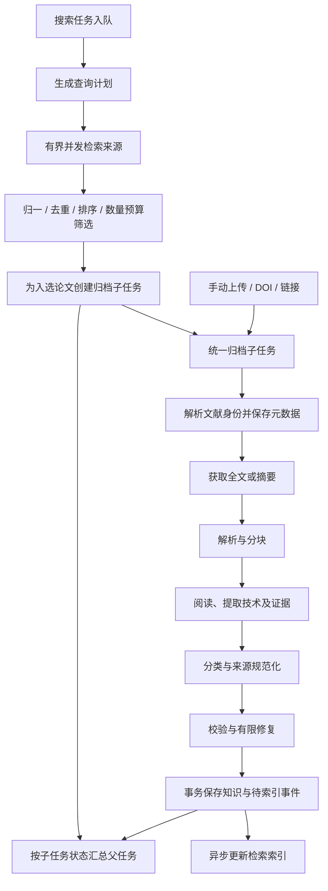
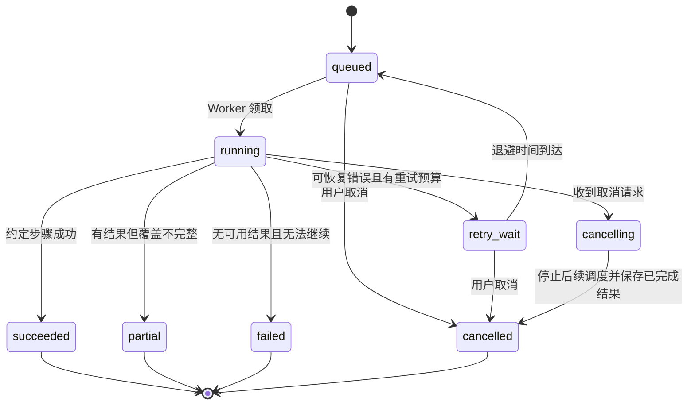
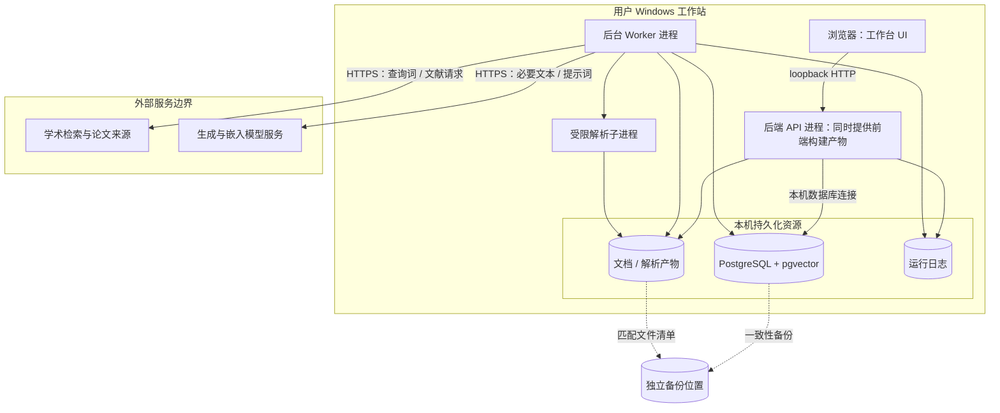
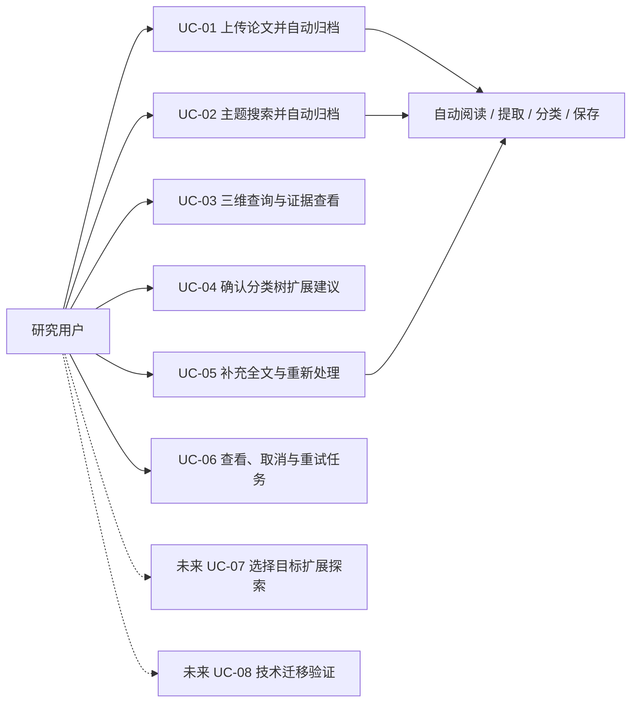
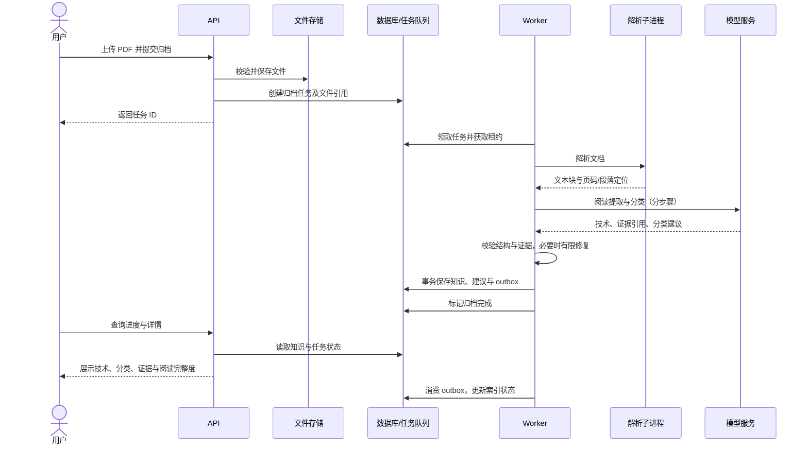
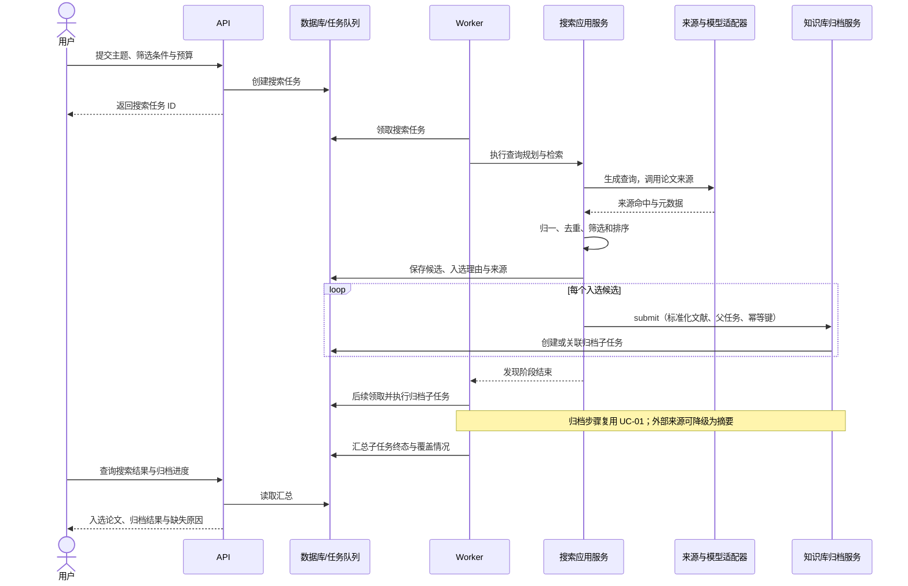

# AI Agent 论文工作台：4+1 架构视图

版本：v0.2｜日期：2026-10-24｜状态：目标架构；模块一、二已有首版实现，具体覆盖范围见 [实现与验证记录](05-实现与验证记录.md)。

本文是系统架构的主文档。原《01-系统架构设计》保留为需求背景与初始分类骨架参考；涉及组件职责、运行方式和部署边界时以本文为准。

## 0. 系统范围与视图导航

### 0.1 已确认的范围

用户发起搜索后，系统自动完成检索、阅读、技术提取、分类与归档，不设置人工入库审核。技术树由人工确定骨架，Agent 提出扩展建议，用户确认后变更正式树；该确认不阻塞归档。

本阶段实现模块二（技术知识库）与模块一（论文搜索）。模块三包括用户选择目标的扩展探索，以及技术迁移验证，当前均只预留边界。实施顺序保持：架构 → 模块二详细设计 → 模块一详细设计 → 模块二开发 → 模块一开发 → 模块三。

设计假设：首版单用户、本地部署，支持中文主题与总结，优先处理英文计算机领域论文。这些假设可在详细设计时调整。

### 0.2 五个视图分别回答什么

| 视图 | 要回答的问题 | 本文产物 |
| --- | --- | --- |
| 逻辑视图 | 系统有哪些业务能力、对象及关系？ | 业务组件图、领域关系图、职责与数据所有权 |
| 开发视图 | 源代码如何分解，模块如何依赖与集成？ | 包依赖图、目录规划、接口契约 |
| 进程视图 | 运行时谁执行任务，如何并发、通信和恢复？ | 运行图、任务状态机、一致性与失败策略 |
| 物理视图 | 软件部署在哪些节点，数据和外部边界在哪里？ | 部署图、进程映射、网络与持久化边界 |
| +1 场景视图 | 上述设计如何协同完成用户任务？ | 用例图、关键时序与验收场景 |

图例：实线表示本阶段的关系；标注“未来”的组件不参与首版部署。逻辑组件不是独立服务；Agent 角色不是操作系统进程；同一份后端代码分别由 API 和 Worker 加载。

## 1. 逻辑视图：业务能力与领域对象

### 1.1 业务组件图



搜索负责“找到哪些论文值得处理”，归档负责“论文是什么、提出了什么技术、证据在哪里”。知识查询负责读取已保存的知识，不在用户每次打开页面时重新调用模型。

### 1.2 数据所有权

| 所有者 | 管理的数据 | 对外能力 |
| --- | --- | --- |
| 搜索模块 | 搜索请求、查询式、来源命中、排序结果、候选入选记录 | 创建搜索、读取结果、提交入选项 |
| 知识库文献子模块 | Paper、PaperVersion、Document、Publication、Venue | 规范化身份、查找文献、补充全文 |
| 知识库技术子模块 | Technique、技术与论文关联、Evidence、ExperimentFinding | 保存技术、读取详情与证据 |
| 知识库分类子模块 | 技术树、问题树、分类关联、分类版本、扩展建议 | 自动分类、确认节点建议、重分类 |
| 知识库检索子模块 | 可重建的文本与向量索引 | 三维筛选、关键词与语义检索 |
| 任务平台 | Job、StepRun、租约、预算、执行事件 | 调度、重试、取消、进度汇总 |

“来源域”来自发表记录的结构化事实，不由分类 Agent 猜测；技术域与问题域由模型在正式分类树中选择。数据库可以共享，但其他模块不能越过服务接口直接修改上述数据。

### 1.3 核心领域关系



图为概念关系，不是最终数据库表设计。Claim 表示待展示的技术结论，必须关联证据；推断要额外标记，不能伪装成原文结论。实验发现保留基线、指标、单位、工作负载与适用范围。

关键规则：

- 一篇论文有多个版本；预印本与发表版只有在标识或明确来源关系支持时才归为同一论文。期刊扩展成果默认独立建档并建立“扩展自”关系，不能仅因标题相近合并。
- 技术方案与论文版本通过 TechniqueSource 关联。首版先按论文提取独立技术条目，跨论文同名技术只建立候选关系，不自动合并。
- 技术域与问题域分别维护树，树内单父节点；论文和技术均可关联多个分类节点。来源域通过 Publication 与 Venue 查询。
- 文献可以只有元数据或摘要；没有可靠内容时不生成完整技术结论。Document 也可记录带来源的摘要文本快照。
- 归档完整度至少区分元数据级、摘要级、全文级；它与任务执行状态分开。
- 查不到合适叶节点时先归上级并提出建议；无可信上级则未分类，仍可入库。

## 2. 开发视图：代码组织与依赖规则

### 2.1 开发单元与包依赖

拟采用 React / TypeScript 前端、Python / FastAPI 后端、PostgreSQL 与 pgvector。版本、模型提供方和论文来源在详细设计时验证选定。



箭头表示源码依赖或图上明确标注的通信。业务代码依赖抽象端口，适配器实现端口，装配入口注入具体实现。API 与 Worker 是两个启动入口，不是两套业务实现。

### 2.2 建议目录

```text
apps/
  web/src/features/         # search、knowledge、tasks、taxonomy
backend/
  src/workbench/
    entrypoints/           # API 入口、Worker 入口
    search/                # application、domain、ports、contracts
    kb/                    # application、domain、ports、contracts
      literature/          # 文献身份、版本、文档、发表记录
      techniques/          # 技术、结论、证据、实验发现
      taxonomy/            # 两棵分类树与分类建议
      retrieval/           # 三维筛选与索引查询
    workflows/             # 搜索、归档、重分类、索引流程
    tasks/                 # 持久化任务、租约、预算、取消
    agents/                # 角色定义、输出 schema、提示词版本
    adapters/              # 模型、来源、解析器、数据库、文件存储
    bootstrap/             # 配置与依赖装配
  migrations/              # 数据库结构变更
  tests/                   # 领域、契约、工作流与集成验证
contracts/                 # 导出的 API 契约与前端类型
docs/                      # 架构、模块详细设计、决策记录
```

目录是后续实现规划，本次不创建业务代码。共享层仅容纳真正通用的标识、错误与接口类型，不集中承载业务逻辑。

### 2.3 跨模块契约

| 契约 | 输入概要 | 输出概要 | 约束 |
| --- | --- | --- | --- |
| SearchService.submit | 主题、筛选条件、数量、预算 | search_job_id | 请求只入队，不同步执行长任务 |
| ArchiveService.submit | 候选元数据 / DOI / URL / 文件引用、知识库 ID、幂等键 | archive_job_id、已有文献引用（如有） | 模块一与手动导入共用入口 |
| KnowledgeQuery.search | 技术节点、问题节点、来源、文本、分页 | 条目、匹配依据、完整度 | 联合筛选优先遵守结构化约束 |
| KnowledgeQuery.detail | 论文或技术 ID、可选版本 | 技术、分类、证据、处理来源 | 只读，不自动触发重新提取 |
| TaxonomyService.resolveProposal | 建议 ID、接受/拒绝/调整、版本 | 新分类版本、可选重分类任务 | 版本冲突不能静默覆盖 |
| TaskService.get/cancel/retry | 任务 ID、操作上下文 | 状态与子任务统计 | 重试复用成功产物，取消停止后续调度 |

契约在模块二详细设计时先定型，模块一详细设计验证其足以承接搜索结果。前端通过 API 使用契约；后端内部采用服务调用，无须内部 HTTP。

### 2.4 Agent 与普通程序的边界

| 步骤 | Agent 负责 | 程序负责 |
| --- | --- | --- |
| 搜索 | 术语扩展、查询规划、语义相关性判断 | 来源调用、身份归一、硬性条件、数量与配额 |
| 阅读提取 | 技术机制、问题、假设、局限与结论抽取 | 分块、定位、结构校验、证据 ID 有效性 |
| 分类 | 从候选节点选择分类、提出节点建议 | 节点存在性、版本、关系保存与确认流程 |
| 质量检查 | 辅助检查结论与原文是否相符 | 必填字段、单位结构、引用位置、有限次修复 |

模型的检查不能保证结论正确，仍需通过代表性论文评估提取质量。第一版使用受控工作流执行这些角色，不实现任意工具调用与无限自循环。

## 3. 进程视图：执行、并发与恢复

### 3.1 运行时进程与通信



API 只处理短请求；搜索、文档处理、模型推理、嵌入与重分类均在 Worker 执行。首版一个 Worker 进程可并发处理多个受限任务，CPU 密集或可能卡住的解析在有超时和资源限制的子进程中执行。索引任务也由同一 Worker 调度。

### 3.2 工作流与并发边界



图示为正常路径。无全文时走摘要路径；连摘要也没有则保存元数据，跳过技术提取并记录不完整原因。同一文献处理串行化，不同论文可以并发；来源请求和模型调用分别设置并发上限。父任务不占着执行槽等待全部子任务，由持久化状态汇总推进。

### 3.3 状态与完成语义



- Job 表示搜索、归档、重分类或索引任务，StepRun 保存每次步骤尝试与产物。
- 归档成功表示有效知识已提交；索引有独立状态。索引失败不撤销归档，详情和结构化筛选仍可使用，语义检索可能暂未包含新条目。
- 摘要级归档可以是 succeeded；读取完整度独立展示。只有元数据而无法完成阅读时标记 partial，并说明原因。
- 搜索父任务在发现阶段结束且归档子任务全部进入终态后汇总完成；展示发现数、入选数、归档成功数、部分完成数与失败数。
- 来源故障或预算截断导致未完成预定范围时，父任务为 partial。取消是独立终态，保留已有结果。

### 3.4 可靠性与一致性

| 风险 | 处理策略 |
| --- | --- |
| Worker 崩溃 | 持久化步骤结果、租约与心跳；租约到期后可重新领取，从检查点继续 |
| 旧 Worker 恢复后继续写入 | 每次领取生成租约代次，提交时校验代次，拒绝过期持有者写入 |
| 同一论文重复进入 | 数据库唯一约束、身份解析和任务幂等键共同控制；标题近似只产生候选关系 |
| 外部模型重复调用 | 接受任务至少执行一次的现实；复用已保存结果，外部调用超时可能产生重复费用，不承诺恰好一次 |
| 两个任务重复或覆盖知识 | 按论文版本控制有效处理版本，提交时检查输入与处理版本；失败不替换已有有效结果 |
| 知识已写入但索引遗漏 | 同一事务写知识与 outbox 事件，索引消费幂等且可重试 |
| 文件与数据库不一致 | 文件先写临时位置、校验哈希后原子落盘，再提交引用；孤立文件延迟清理，不删除被引用文件 |
| 模型输出不合格 | 结构校验、证据引用校验、有限次修复；保留失败原因而不写入无效结论 |
| 用户取消或预算不足 | 调度前检查取消状态与剩余预算；并发调用先预留预算再结算，已发出的请求可能无法撤销 |

幂等处理键至少包含知识库、文献版本、内容哈希、流程版本、模型/提示词版本；分类步骤额外包含分类树版本，向量步骤包含嵌入模型版本。具体键与唯一约束在详细设计中落表。

## 4. 物理视图：部署节点与数据边界

### 4.1 首版部署拓扑



首版默认 API 只监听本机回环地址，数据库不对外公开。前端静态文件由 API 提供，同源访问降低部署复杂度；开发时可以使用独立前端开发进程。PostgreSQL 是独立数据库进程，不是 API 进程内的存储。

PostgreSQL 采用原生安装或本机容器承载，需在详细设计时根据环境与扩展可用性二选一验证；拓扑与业务接口不依赖该选择。本图不是已经完成的环境部署清单。

### 4.2 软件到节点的映射

| 部署单元 | 所在节点 | 包含内容 | 持久化 |
| --- | --- | --- | --- |
| 浏览器 UI | 用户工作站 | 前端页面、交互状态 | 不保存模型密钥或主业务数据 |
| API 进程 | 用户工作站 | API 路由、应用服务、只读检索、任务提交 | 数据库与文件存储 |
| Worker 进程 | 用户工作站 | 工作流、Agent、来源和模型适配器、索引消费 | 数据库步骤记录与文件产物 |
| 解析子进程 | 用户工作站 | 文档解析器、可选 OCR | 临时文件与解析输出 |
| 数据库进程 | 用户工作站 | 主数据、任务、outbox、文本与向量索引 | 数据库专用目录/卷 |
| 外部模型服务 | 服务商节点或未来自托管节点 | 生成与嵌入能力 | 遵循具体提供方配置与数据策略 |

文件路径统一由 StoragePort 管理，不把本机绝对路径暴露为跨模块文献标识。未来将 Worker 移到其他主机前，需先共享或替换文件存储；不能仅扩容进程数量就假定文件可访问。

### 4.3 部署与运维约束

- 密钥通过后端配置加载，日志脱敏；发送给外部模型的材料范围应明确可见。
- URL 下载检查协议、解析后的地址和重定向，阻止读取本机、内网和云元数据地址；设置大小、超时与类型限制。
- PDF 与网页中的指令视为内容，不获得工具执行权限。解析进程限制时间与资源，隔离具体机制在部署设计中确定。
- 数据库与文件需共同备份，保存数据库快照对应的文件清单；索引允许恢复后重建。
- 初始并发、容量、延迟与费用目标在代表性论文试运行后确定，本阶段不承诺未测量的性能指标。
- 后续若开放远程访问，需要加入认证、TLS 与访问控制；这不属于当前单机部署能力。

## 5. +1 场景视图：用例驱动与架构验证

### 5.1 用例总览



### 5.2 UC-01：上传论文并自动归档（模块二独立验收）

前置条件：知识库与初始分类树已建立，模型与解析能力已配置。输入为 PDF；结果为可查询的论文及有证据支撑的技术条目。



异常路径：扫描文件且无 OCR 能力时记录解析失败；没有合适分类时自动归上级或未分类；结构无效且修复耗尽时保留文献与失败记录，不生成虚假的完整技术条目。

验收：无需人工审批；每个重要结论可打开对应证据；重复上传不制造重复论文；归档完成后索引状态单独可见。

### 5.3 UC-02：主题搜索并自动归档（模块一与模块二联调）

示例输入：“Cache 压缩对访存性能的影响”，同时指定年份、最多归档数量和预算。



异常路径：一个来源失败不终止其他来源；全文不可达但摘要可用时摘要级归档；预算耗尽停止新调用并保存已完成结果；候选与现有论文重复时关联已有文献及必要的补充任务。

验收：从用户提交到归档结束无需再次确认；数量与预算受约束；每篇结果可追溯到查询来源；任务完成范围清晰可见。

### 5.4 其他架构验证场景

| 用例 | 执行链路 | 预期结果 / 异常处理 |
| --- | --- | --- |
| UC-03 三维查询 | UI → API → KnowledgeQuery → 结构化筛选/索引 → 详情与证据 | 技术域、问题域和来源同时生效；索引滞后可见，不把未索引误报为不存在 |
| UC-04 分类扩展 | 用户处理建议 → 分类服务提交新版本 → 重分类任务 → 索引更新 | 自动归档早已完成；确认后更新受影响条目，保留历史分类依据 |
| UC-05 补全文 | 上传文档 → 文献身份匹配 → 新处理记录 → 校验成功后切换有效版本 | 不重复建论文；失败保留原摘要级结果；新旧文档证据不混用 |
| UC-06 重试与取消 | API 写取消标志或创建重试 → Worker 检查 → 保存结果/停止调度 | 父任务取消传播到未完成子任务；共享于其他父任务的子任务不被错误取消 |
| 崩溃恢复 | Worker 停止 → 租约过期 → 新领取 → 复用已保存产物 | 旧租约不能覆盖新结果，任务不会永久停留运行中 |
| UC-07 未来探索 | 选择方向及目标 → 知识上下文 → SearchService | 复用搜索与归档能力，本阶段不实现探索策略 |
| UC-08 未来迁移 | 选择技术方案 → 读取机制、条件与证据 → 后续验证服务 | 当前无执行服务、实验环境或验证结论，仅保留概念边界 |

## 6. 视图之间的对应与设计落点

| 场景 | 逻辑组件 | 开发单元 | 运行进程 | 部署资源 |
| --- | --- | --- | --- | --- |
| UC-01 自动归档 | 文献、提取、分类、知识保存 | kb、agents、archive workflow | API → Worker → 解析子进程 | 本机文件、数据库、外部模型 |
| UC-02 自动搜索 | 查询规划、来源检索、排序、归档 | search、source adapters、kb contracts | API → Worker | 论文来源、外部模型、数据库 |
| UC-03 知识查询 | 三维检索、详情与证据 | kb/retrieval、query contracts | API | 数据库索引、本机文档 |
| UC-04 分类维护 | 分类树、建议、重分类 | kb/taxonomy、reclassify workflow | API → Worker | 数据库、模型服务 |
| UC-05 丰富归档 | 文献版本、有效处理记录 | kb/literature、archive workflow | API → Worker | 文件、数据库、模型服务 |
| UC-06 任务控制 | 调度、取消、重试、预算 | tasks、workflows | API ↔ Worker（经数据库） | 数据库、日志 |

由此得到三个明确边界：

1. **业务边界**：搜索发现候选，知识库拥有正式文献与技术数据，未来应用消费这些能力。
2. **执行边界**：API 响应交互，Worker 执行长任务，解析子进程处理文档，模型服务承担语义推理。
3. **持久化边界**：数据库是业务事实与任务状态来源，文件保存原文与产物，索引可重建。

## 7. 架构决策与下一阶段输入

| 决策 | 原因与代价 |
| --- | --- |
| 模块化单体 + 独立 Worker | 支持模块独立开发且减少部署复杂度；需严格执行包与数据所有权边界 |
| 持久化工作流驱动 Agent | 可限制成本、恢复任务、追溯结果；探索策略必须显式设计 |
| PostgreSQL 同时保存任务与知识 | 首版减少基础设施；高负载时需评估数据库队列竞争 |
| 知识事务提交，索引异步更新 | 避免索引失败丢失知识；需展示索引滞后并支持重建 |
| 正式分类树与扩展建议分离 | 保持结构稳定且归档全自动；新方向暂时可能只归上级节点 |
| 论文、技术、证据分别建模 | 支持跨论文研究与后续迁移分析；实体归一需保守处理 |

模块二详细设计应首先落实：实体字段与唯一约束、分类版本策略、归档/查询契约、状态迁移表、证据定位格式、原文解析能力、页面交互及代表性论文验收集。模块一详细设计随后落实来源选择、检索配额、查询与排序策略，以及对归档契约的联调验证。

本文件保留目标架构的五个视图及其映射。实际实现、验证证据与尚未覆盖的目标见 [实现与验证记录](05-实现与验证记录.md)，接口与默认值见模块一、二详细设计。
